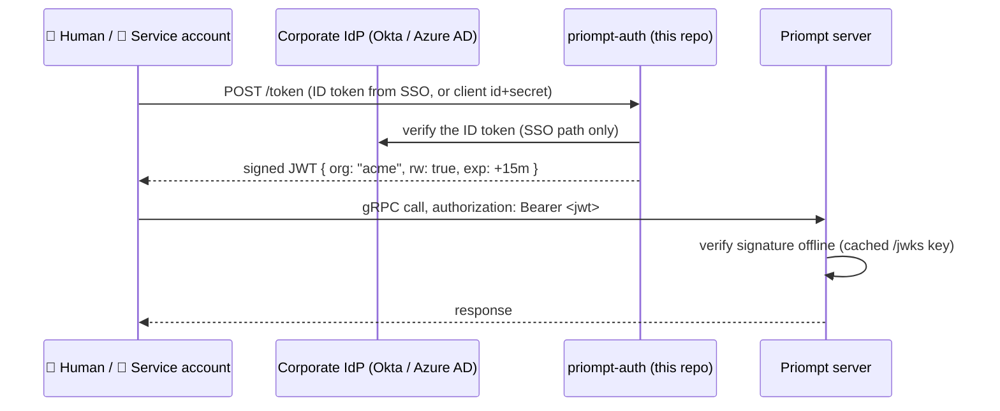

# priompt-auth

**The ID-card office for Priompt.** It trades a credential your company already
trusts — a corporate SSO login, or a service-account secret — for a
**short-lived pass** (a signed JWT) that the
[Priompt](https://github.com/) server accepts. The server checks passes on its
own, without phoning this service, so issuing and serving never share fate.

## The 30-second version

Static tokens in a file are fine until an enterprise asks: *how do people log
in with SSO? what happens when an employee leaves? how do we rotate secrets?*
`priompt-auth` answers all three without making the prompt server any slower
or any less available:



- **Tokens live minutes, not months** — leaked credentials expire on their own.
- **Offboarding is the IdP's job** — leave the Okta group, and the next token
  request fails; the current token dies at `exp`.
- **No availability coupling** — if this service is down, already-issued
  tokens keep verifying until they expire. The server never calls it per
  request.
- **Stateless** — no sessions, no password storage, no database. The only
  secrets it holds are one signing key and (hashed) service-account secrets.

## Quick start

```sh
go build -o priompt-auth .            # Go 1.25+

# 1. one-time: generate the signing keypair
./priompt-auth init                   # -> auth.key (kid printed)

# 2. mint a service-account credential (an agent, a CI job…)
./priompt-auth gen-secret ci-bot acme rw
#   client_secret (give to the client, shown once):  <secret>
#   clients.txt line (safe to commit — it is a hash): ci-bot sha256:… acme rw

# 3. run the issuer
./priompt-auth serve -clients-file clients.txt        # :8444

# 4. tell the Priompt server to trust it
priompt serve -auth-jwks-url http://localhost:8444/jwks
```

Get a token and use it — any Priompt client accepts it as a normal bearer
token (`PRIOMPT_TOKEN`, `PRIOMPT_URL`, `token=` — nothing changes):

```sh
curl -s -X POST localhost:8444/token \
  -d grant_type=client_credentials -d client_id=ci-bot -d client_secret=<secret>
# {"access_token":"eyJ…","token_type":"Bearer","expires_in":900}

PRIOMPT_TOKEN=eyJ… priompt list -prefix priompt://acme/ -addr localhost:8443
```

Static tokens keep working alongside JWTs — migration is gradual, and local
development never needs this service at all.

## SSO (OIDC) login for humans

Point the service at your IdP and map its groups to Priompt permissions. We do
**not** host a login page — your enterprise already has one; we only verify
its output (an RS256 ID token) against the IdP's published keys:

```sh
./priompt-auth serve -clients-file clients.txt \
  -oidc-issuer https://your-org.okta.com -oidc-audience priompt \
  -groups-file groups.txt
```

```text
# groups.txt — first matching line wins; no org = admin (all orgs)
prompt-admins            rw     # platform team: everything, may write
acme-authors    acme     rw     # acme's prompt writers
acme-readers    acme            # acme's read-only consumers
```

Exchange an ID token for a Priompt token:

```sh
curl -s -X POST localhost:8444/token -d grant_type=oidc -d id_token=<IdP ID token>
```

The service checks the ID token's signature (via the issuer's JWKS), issuer,
expiry, and — if `-oidc-audience` is set — audience, then maps the caller's
`groups` claim through `groups.txt`.

## Service accounts

For agents, CI, and anything non-human. Credentials are OAuth2
client-credentials: an id and a secret. Only the **hash** of the secret is
stored, so `clients.txt` is safe to keep in config management:

```text
# clients.txt — client_id sha256:<hex> [org] [rw]
ci-bot        sha256:d430dc…   acme   rw
dashboard     sha256:9f11ab…   acme
```

`priompt-auth gen-secret <id> [org] [rw]` generates the pair and prints both
halves. Revoke by deleting the line and restarting.

## What an issued token says

Compact EdDSA (Ed25519) JWT. The claims contract is **defined once in the
shared proto repo (`priomptproto/claims`)** and imported by both this issuer
and the core server's verifier — the two halves cannot drift:

| Claim | Example | Meaning |
| --- | --- | --- |
| `sub` | `ci-bot`, `sujal@acme.com` | who this token was issued to (lands in audit logs and commit authorship) |
| `org` | `acme` (`""` = admin) | org scope — same rule as static tokens: only `priompt://acme/…` |
| `rw` | `true` | may publish/branch/merge/rollback; read-only otherwise |
| `exp` / `iat` | unix seconds | always set; default TTL 15 minutes (`-ttl`) |
| `iss` | `priompt-auth` | issuer name |

The header carries a `kid`; the server fetches keys from `GET /jwks`, caches
them, and re-fetches (rate-limited) on an unknown `kid` — so key rotation
needs no server restart.

## Operations

- `GET /healthz` — liveness for your load balancer.
- **Audit** — one structured (slog JSON) line per issuance and per denial on
  stderr: subject, org, grant type, reason.
- **Rotation** — `init -force` + restart. Outstanding tokens die early,
  bounded by the TTL (minutes). A `-prev-key-file` served alongside in the
  JWKS is the documented upgrade when zero-drop rotation is required.
- **Flags** — `serve`: `-addr` (default `:8444`), `-key-file`,
  `-clients-file`, `-groups-file`, `-oidc-issuer`, `-oidc-audience`, `-ttl`.

## Relation to the other repos

| Repo | Role |
| --- | --- |
| **priompt** | Imports `priomptauth/authn` for *all* authentication and runs it with `-tokens-file` / `-auth-jwks-url`. Core itself holds no credential code — only authorization (org scoping, the write gate) |
| **proto** | Hosts the shared claims contract (`priomptproto/claims`) both repos import |
| **python-sdk / js-sdk / cli** | Unchanged — a JWT is just a bearer token to them |

## `authn` — the importable half

This repo is two things: the `priompt-auth` **binary** at the root, and the
`priomptauth/authn` **package** it and the core server both import.

`authn` owns every credential mechanic in the family:

| | |
| --- | --- |
| `MintJWT`, `JWKSJSON`, `KeyID` | issuing — used by this binary |
| `KeySet.Verify` | verifying — used by the core server |
| `LoadTokens`, `GenToken`, `Token` | the static tokens file |
| `Provider`, `NewStatic`, `NewJWKS`, `Interceptor`, `Identity` | the gRPC gate and its pluggable providers |

Minting and verification sitting in one package is the point: the two halves of
the token format cannot drift, and the round trip is testable in one place
(`TestMintVerifyRoundTrip`). Previously the verifier was a second, hand-kept
copy inside the server.

Core imports this package but **never calls this service** — verification is
offline against cached `/jwks` keys, so `priompt` build-depends on the auth repo
while staying runtime-independent of the auth process.

Tests: `go test ./...` (covers minting, verification, the tokens file, the gRPC
gate, client credentials, and the OIDC exchange against a fake IdP — no real
IdP needed).
